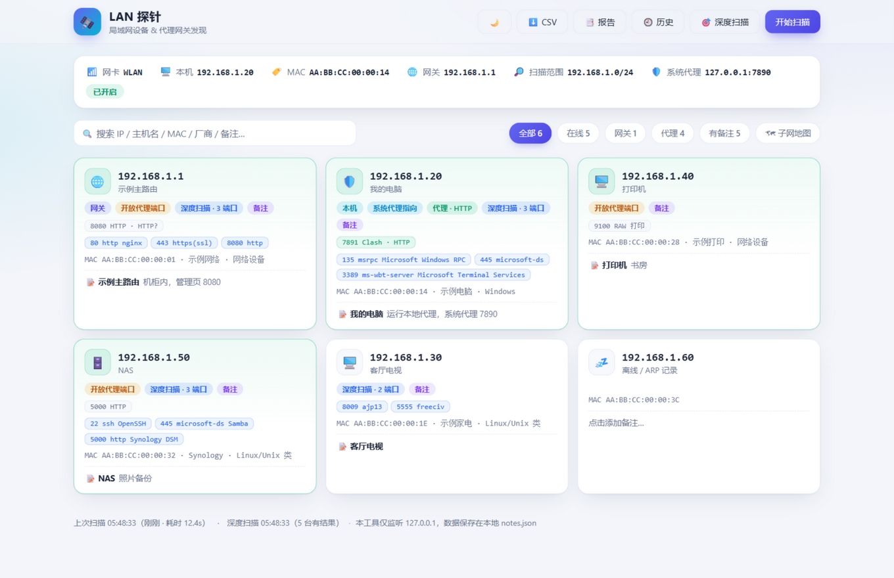
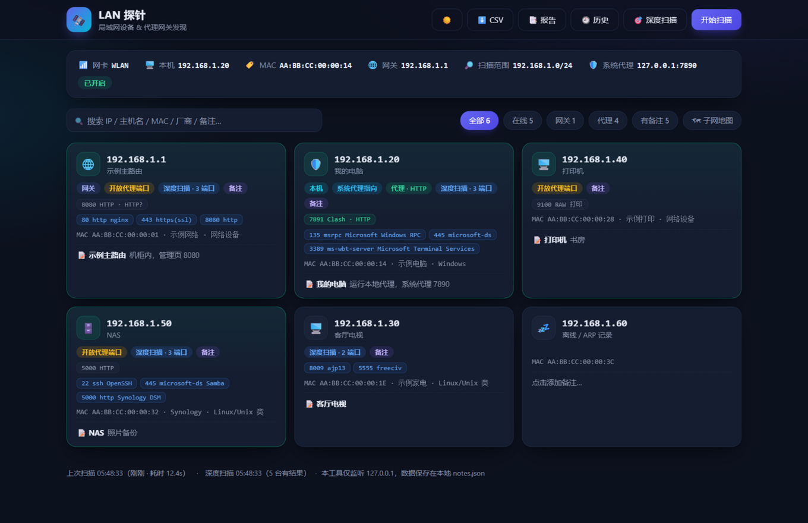

<div align="center">

# 🛰️ networkmap

**发现局域网设备、识别代理网关，并给每台设备建立可长期维护的备注台账。**

零第三方依赖 · 单文件 exe · 仅监听本机

[](https://www.python.org/)
[](#)
[](LICENSE)
[](#依赖)
[](https://github.com/adeople/networkmap/actions/workflows/build.yml)

</div>



<details>
<summary>深色主题</summary>



</details>

> 截图使用虚构的演示数据（IP / MAC / 备注均为示例），不包含任何真实局域网信息。

---

## 功能

- **设备发现**：Ping 扫描 + ARP 表 + TCP 存活探测，能发现不响应 ping 的设备；
  自动识别网关、本机、操作系统类型与网卡厂商
- **代理网关识别**：探测 19 个常见代理端口（Clash / v2rayN / SOCKS5 / Squid / Surge 等），
  并用 HTTP / SOCKS5 协议握手 + 响应体校验区分“已确认代理”与“疑似端口”，
  同时读取 Windows 系统代理状态并标记对应设备
- **设备备注台账**：点击卡片即可填写备注名称与内容，以 MAC 为键持久化，
  设备换 IP 备注不丢；支持按备注筛选
- **nmap 深度扫描**：端口档位（200 / 1000 / 65535）、T3/T4 速度、
  NSE 服务信息脚本（网页标题、SSL 证书、SMB 系统信息等）与 vuln 漏洞脚本；
  支持单 IP、CIDR（`192.168.1.0/24`）与范围（`192.168.1.1-254`）目标
- **nmap 自愈**：启动前自动健康检查，检测到 nmap 加密库被本机其他组件篡改时，
  自动用 scoop 重装后再继续扫描
- **扫描历史与对比**：保留最近 30 次快照，一键对比新上线 / 离线 / 端口变化
- **子网地图**：254 格彩色网格，直观查看整段地址的在线、网关、代理与备注分布
- **报告导出**：设备清单 CSV 与独立 HTML 扫描报告
- **网络唤醒**：设备弹窗内一键发送 WOL 魔术包，远程开机
- **快捷操作**：按端口动态生成管理页 / HTTPS / 共享文件夹入口，
  复制远程桌面（mstsc）与 SSH 命令
- **自动巡检 + 新设备提醒**：后台定时扫描（1~60 分钟可调），
  发现新设备即时 toast / 浏览器通知
- **设备类型标注**：九类设备图标分类，随备注持久化，搜索与 CSV 同步
- **手机 / iOS**：响应式界面 + PWA，可「添加到主屏幕」像原生 App 一样全屏使用；
  电脑端 `--lan` 启动后扫码即可在手机上打开，无需登录

---

## 手机 / iOS 使用

手机无法做 ARP / ICMP 扫描，因此手机端是**电脑扫描引擎的移动操作端**：
扫描由电脑执行，手机负责查看、筛选与备注。

```bat
:: 电脑上以局域网模式启动（手机与电脑需连同一 Wi-Fi）
networkmap.exe --lan
:: 源码运行：python server.py --lan
```

启动后控制台会打印手机访问地址，界面里点「📱 手机访问」会显示二维码：

| 平台 | 安装到主屏幕 |
|---|---|
| **iPhone / iPad** | Safari 打开 → 底部「分享」→「添加到主屏幕」→「添加」，之后从桌面图标全屏运行 |
| **Android** | Chrome 打开 → 右上「⋮」→「添加到主屏幕」 |

说明：

- 局域网模式监听 `0.0.0.0`，同一 Wi-Fi 内的设备**打开链接即可使用，无需登录**
- 默认仍只监听 `127.0.0.1`，不开启 `--lan` 时手机无法访问
- 请在可信网络中开启；用完关闭窗口即可撤销访问
- 界面为响应式布局：手机上是单列卡片、底部抽屉式弹窗、横向滑动的筛选条

---

## 快速开始

### 方式一：直接运行 exe（无需 Python）

从 [Releases](../../releases) 下载最新 `networkmap-v*.exe`，双击运行，浏览器会自动打开
<http://127.0.0.1:8791>。

### 方式二：源码运行（零第三方依赖）

```bat
git clone https://github.com/adeople/networkmap.git
cd networkmap
python server.py
```

无需 `pip install`，仅使用 Python 标准库。

### 深度扫描（可选）

深度扫描调用本机 nmap，安装任一方式即可：

```bat
scoop install nmap
:: 或从 https://nmap.org/download.html 下载安装
```

本工具使用 `-sT` TCP connect 模式，**不需要管理员权限**；
nmap 的 UDP / SYN 扫描与 OS 指纹才需要 Npcap 驱动。

---

## 依赖

| 依赖 | 运行工具 | 深度扫描 | 说明 |
|---|---|---|---|
| Windows 10/11 x64 | ✅ | ✅ | 使用系统自带 `arp` / `ping` / `route` / PowerShell |
| 现代浏览器 | ✅ | ✅ | Edge / Chrome / Firefox |
| Python 3.10+ | 源码运行必需 | — | exe 已内置运行时 |
| nmap 7.9x | ❌ | ✅ | 不装则其余功能全部可用 |
| scoop | ❌ | ⭕ | 仅用于 nmap 自愈重装 |

**打包依赖**：Python 3.10+、PyInstaller 6.22+、Windows x64（不支持跨平台打包）。

```bat
python -m pip install pyinstaller
python build_exe.py
:: 产物：dist/networkmap.exe（单文件，约 10 MB）
```

---

## 自动化构建

仓库内置 [`.github/workflows/build.yml`](.github/workflows/build.yml)，在 Windows 运行器上自动打包并做启动冒烟测试：

| 触发方式 | 行为 |
|---|---|
| 推送到 `main` / 提交 PR | 构建 exe，启动后请求 `/api/state` 校验服务可用 |
| Actions 页面手动 Run workflow | 同上，产物可在运行记录的 Artifacts 中下载（保留 30 天） |
| 推送 `v*` 标签 | 构建通过后自动上传 `networkmap-<tag>.exe` 到对应 Release |

```bat
:: 发布新版本：打 tag 并推送，Actions 会自动构建并挂到 Release
git tag -a v0.2.0 -m "v0.2.0"
git push origin v0.2.0
```

---

## 数据与隐私

首次运行会在 **exe / 脚本所在目录** 生成以下文件（目录不可写时回退到
`%LOCALAPPDATA%\networkmap`）：

| 文件 | 内容 |
|---|---|
| `notes.json` | 设备备注（含 MAC，作为稳定键） |
| `history.json` | 最近 30 次扫描快照 |
| `nmap_results.json` | 深度扫描结果与 NSE 输出 |
| `nmap-last.xml` | 最近一次 nmap 原始 XML |

这些文件包含你的局域网设备信息，**已加入 `.gitignore`，不会被提交**。
迁移时把 exe 与这些 json 一起拷走即可保留台账。

界面只监听 `127.0.0.1`，不对局域网暴露；扫描均为只读探测，不修改任何设备。
使用 `vuln` 漏洞脚本请仅针对自有设备。

---

## 项目结构

```
networkmap/
├── server.py          # 内置 Web 服务与 API（标准库 http.server）
├── scanner.py         # 常规扫描：存活探测 / 代理端口 / 主机名 / 厂商
├── nmapscan.py        # nmap 深度扫描：调度 / 进度 / XML 解析 / 自愈
├── paths.py           # 源码与打包统一的资源、数据路径
├── static/            # 前端（原生 HTML / CSS / JS，无框架）
├── tools/make_icon.py # 纯代码生成应用图标
├── build_exe.py       # 一键打包
└── dist/              # 打包产物（已 gitignore）
```

---

## 常见问题

**Q：Windows 提示“已保护你的电脑”？**
exe 未做代码签名，点「更多信息 → 仍要运行」即可。也可直接用源码方式运行。

**Q：深度扫描报 nmap 进程崩溃？**
本工具会先做健康检查，检测到 nmap 文件损坏或被篡改时自动重装；
若自动修复失败，执行 `scoop uninstall nmap && scoop install nmap`。

**Q：手机打不开？**
确认电脑是以 `--lan` 启动、手机与电脑连同一 Wi-Fi（不是访客网络），
并在 Windows 防火墙提示中允许 networkmap（专用网络）。

**Q：端口 8791 被占用？**
会自动顺延到下一个可用端口，控制台会打印实际地址；
也可用 `python server.py --port 8800` 指定。

**Q：有些设备显示“未知厂商”？**
手机默认开启 MAC 随机化，无法匹配 OUI 厂商库，属正常现象。

**Q：扫描会影响网络吗？**
常规扫描为只读探测（Ping / ARP / TCP 连接 + 少量代理端口握手），
不会发送攻击流量；深度扫描强度取决于所选 NSE 脚本。

---

## 更新日志

见 [CHANGELOG.md](CHANGELOG.md)。

## License

[MIT](LICENSE)
